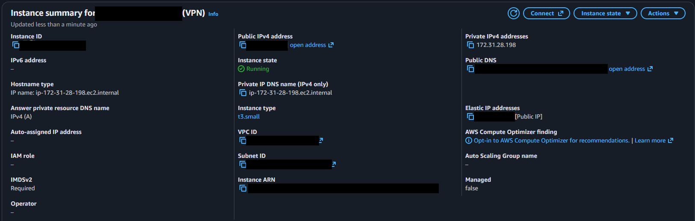
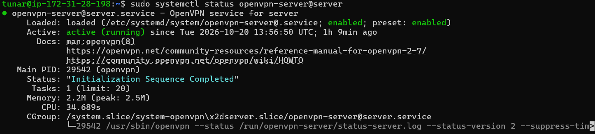
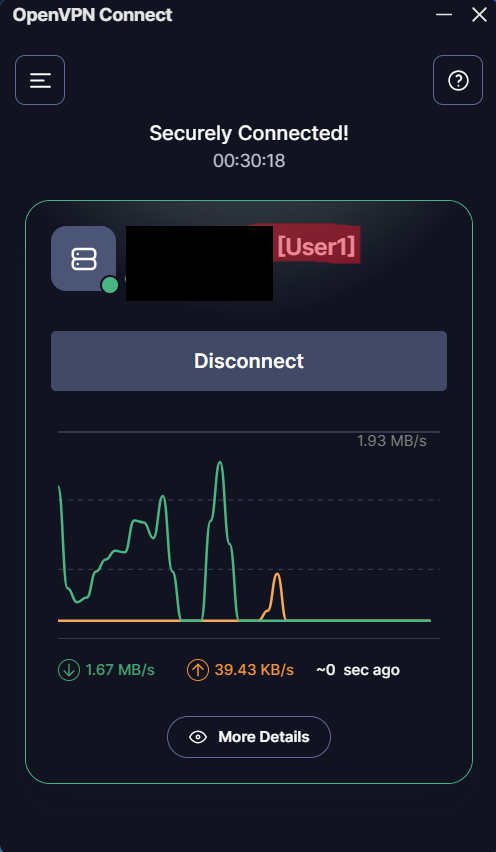
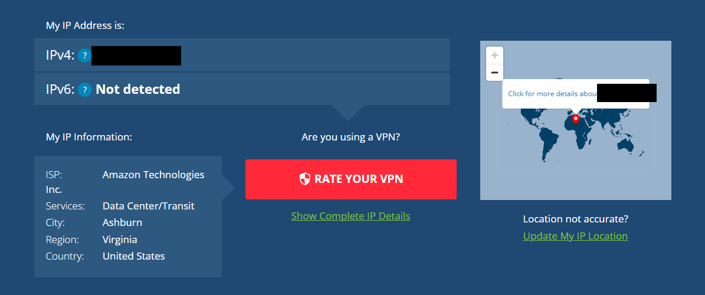

# Building my own OpenVPN server on AWS EC2

A cybersecurity side project: I set up a private VPN server on AWS so a friend and I, living in different houses, can sit on the same virtual network and ping each other. Along the way I wanted to actually understand what's going on under the hood (certificates, routing, NAT, firewall rules) instead of just clicking "connect" in a commercial VPN app.

> **Status:** server is running and working. Some of the testing and hardening items below are still marked as TODO. I'll tick them off as I finish them.

## Why I did this

- I wanted hands-on practice with AWS, Linux and networking.
- I wanted to learn how a PKI (certificate authority, server cert, client certs) works in a real setup.
- My friend and I wanted a private network to ping and play around on without port forwarding on either home router.

Honest note: if you only want to connect two PCs, Tailscale or ZeroTier is much faster and free. I did this one the hard way on purpose, because the learning was the point.

## Architecture

```
   My PC (10.8.0.2)                                  Friend's PC (10.8.0.3)
        |                                                    |
        |  encrypted tunnel (UDP 1194)                       |  encrypted tunnel (UDP 1194)
        v                                                    v
   +------------------------------------------------------------+
   |        AWS EC2 (t3.small, Ubuntu 24.04), Elastic IP         |
   |        OpenVPN server, VPN subnet 10.8.0.0/24               |
   |        NAT + IP forwarding                                  |
   +------------------------------------------------------------+
                              |
                              v
                          Internet
```

The VPN addresses above are just examples. Yours will be assigned by the server.

## What I used

| Part | Choice |
|---|---|
| Cloud | AWS EC2, `t3.small` (2 vCPU, 2 GiB RAM) |
| OS | Ubuntu Server 24.04 LTS (x86_64) |
| VPN | OpenVPN, installed with the [angristan/openvpn-install](https://github.com/angristan/openvpn-install) script |
| Auth | PKI mode (own CA, server cert, one client cert per device) |
| Protocol / port | UDP 1194 |
| DNS pushed to clients | Cloudflare (1.1.1.1) |
| Fixed address | AWS Elastic IP |
| Clients | OpenVPN Connect |

**Credit:** the heavy lifting of generating the CA, certs and server config is done by Nyr/angristan's installer script. This repo is my documentation, my choices, and my testing around it, not a replacement for that project.

## How I set it up

Short version below. The full step-by-step with commands is in [`docs/setup-steps.md`](docs/setup-steps.md).

1. Launched the EC2 instance in `us-east-1` (t3.small, Ubuntu 24.04).
2. Security group: SSH (22) and UDP 1194 for OpenVPN.
3. Attached an Elastic IP so the address survives stop/start.
4. Turned off the source/destination check so the instance can forward VPN traffic.
5. Created my own admin user (`tunar`) instead of working as the default `ubuntu` user.
6. Ran `apt update && apt upgrade`, then the installer in interactive mode.
7. Created a client profile (`User1`), downloaded the `.ovpn` with `scp`, imported it into OpenVPN Connect.

**The instance: running, t3.small, Elastic IP attached**



**Security group inbound rules**


## Choices I made, and why

- **PKI mode instead of fingerprint mode:** more to learn, and it lets me revoke a single client without touching the others.
- **One profile per device (multi-device off):** if a device is lost or a friend stops using it, I revoke just that one.
- **Own admin user instead of `ubuntu`:** a small step, but the default username is the first thing bots try.
- **Default encryption settings:** the script's defaults are modern and safe, and I didn't want to weaken them by guessing.
- **Clients can see each other: yes.** This is what makes "ping my friend" work. It's also a risk (see below).

## Testing

Ticked = I did it and have a screenshot. Unticked = still to do.

- [x] Server installed, OpenVPN service **active (running)** and **enabled at boot**
- [x] Client connects with the `.ovpn` profile
- [x] Public IP changes to the AWS server's IP when connected
- [ ] Two clients connected at the same time and pinging each other
- [ ] Stop/start the instance and confirm the VPN comes back on its own
- [ ] Wireshark capture with VPN off vs on
- [ ] Revoke a client and confirm it can no longer connect

**Service running on the server**



**Client connected in OpenVPN Connect**



**My public IP while on the VPN: it's an Amazon server in Ashburn, Virginia, not my home connection**



## Things I learned / problems I hit

- The installer script changed to subcommands (`install`, `client`, `interactive`...). Running it with no arguments only prints the help menu. I needed `sudo ./openvpn-install.sh interactive`.
- The installer detects the *private* IP (172.31.x.x). You have to enter the Elastic IP as the public endpoint.
- A stop/start gives you a new public IP unless you use an Elastic IP, which would silently break every `.ovpn` file.
- Windows blocks incoming ping by default, so two connected clients can't ping each other until you allow ICMP.

## Known issue: SSH is open to the internet

Look at the security group screenshot: port 22 has source `0.0.0.0/0`, so anyone can try to reach SSH. Login needs my private key (no passwords), but it's still more exposure than I want. This is the first thing I'm fixing: change the SSH rule to **My IP**, then retake the screenshot. I'm leaving it documented here because it's a good example of the gap between "it works" and "it's secure".

## Risks and what I'd do differently

- **Client-to-client access** is convenient here but means any connected user can reach every other user's machine. In a bigger setup I'd turn it off or add firewall rules.
- **The server owner (me) can see unencrypted traffic that leaves the tunnel.** A VPN moves trust, it doesn't remove it. More in [`docs/threat-model.md`](docs/threat-model.md).
- **`.ovpn` files contain private keys.** Sending them over chat or email is risky. I'd use a password-protected profile or a secure channel.
- **Cost:** about $15/month if left running 24/7 on `t3.small`, less with free tier credits. I stop the instance when I'm not using it.

## Hardening (planned / in progress)

See [`scripts/hardening.sh`](scripts/hardening.sh):

- [ ] fail2ban for SSH
- [ ] Automatic security updates (`unattended-upgrades`)
- [ ] Restrict SSH to my IP only (see known issue above)
- [ ] Confirm SSH key-only login and no root login
- [ ] Review `server.conf` and explain each setting
- [ ] Encrypt the EBS volume

## Repo layout

```
.
├── README.md
├── LICENSE
├── .gitignore
├── docs/
│   ├── setup-steps.md      full commands, start to finish
│   ├── threat-model.md     what this VPN does and doesn't protect
│   └── screenshots/        5 sanitized screenshots
├── configs/
│   └── README.md           how to share a sanitized server.conf
└── scripts/
    └── hardening.sh        fail2ban + auto updates + SSH checks
```

## Security note

This repo contains **no** keys, certificates, `.ovpn` files, or real IP addresses, and the `.gitignore` is set up to keep it that way. If you fork this, please keep it that way too.

## License

MIT for my docs and scripts. The installer script belongs to its own authors and has its own license.
